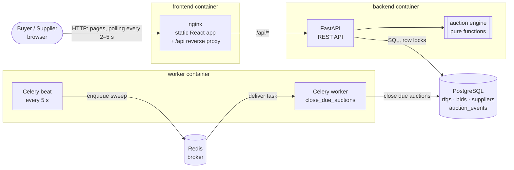

# High-level design

## What it does

Buyers create RFQs that run as British auctions. Suppliers submit quotes and
can only lower their own price. A qualifying bid in the last **X** minutes
moves the close time **Y** minutes later, but never past the **forced close**.
Everyone sees the live ranking (L1, L2, …), the countdown, and an activity log
that gives the reason for every extension.

The exact rules are in [auction-rules.md](auction-rules.md). The tables are in
[schema.md](schema.md).

## Architecture



| Component | Technology | Responsibility |
|---|---|---|
| Frontend | React 19, TypeScript, Vite, served by nginx | List, create and details pages; live countdown on the server's clock; polling |
| API | FastAPI, Pydantic v2, SQLAlchemy 2 | Validation, REST endpoints, transactions |
| Auction engine | Plain Python (`app/engine.py`) | Ranking, trigger detection, capped extension, status. No I/O, fully unit-tested |
| Database | PostgreSQL 16, Alembic migrations | Source of truth. CHECK constraints enforce the forced-close cap |
| Background jobs | Celery + Redis | Closes auctions on time and logs the close, even when nobody is watching |

## Placing a bid

This is the core flow, and the one where correctness matters most.

```mermaid
sequenceDiagram
    autonumber
    participant S as Supplier (browser)
    participant A as FastAPI
    participant E as Engine
    participant DB as PostgreSQL

    S->>A: POST /api/rfqs/{id}/bids
    A->>A: now = server clock
    A->>DB: BEGIN; SELECT rfq ... FOR UPDATE
    Note over A,DB: Other bids on this RFQ wait here
    A->>DB: latest bid per supplier (DISTINCT ON)
    A->>E: validate_bid(now, window, own previous price)
    E-->>A: ok, or rejected with a reason (HTTP 409)
    A->>E: evaluate_bid(ranking before, new bid, X, Y, trigger)
    E-->>A: ranking after, triggered?, new close (capped), reason
    A->>DB: INSERT bid, INSERT BID_PLACED event
    opt trigger fired
        A->>DB: UPDATE rfq.current_close_at, INSERT TIME_EXTENDED (or EXTENSION_BLOCKED)
    end
    A->>DB: COMMIT (releases the lock)
    A-->>S: 201 {rank, extended, new close, reason}
```

## Design decisions

**The server clock decides.** Clients never send a bid time. Every response
includes `server_time`, and the UI counts down on an offset from it, so a viewer
with a wrong clock still sees the right countdown. The server still makes the
final call on every bid.

**One lock per RFQ.** A bid runs in a single transaction that starts with
`SELECT … FOR UPDATE` on its RFQ row. Without the lock, two bids in the same
instant would both read a close time of 18:00 and both write 18:05: one
extension would be lost. A test runs exactly that race, and fails when the lock
is removed. Bids on different RFQs don't block each other.

**The rules are pure functions.** `app/engine.py` has no database or HTTP code.
All three trigger types, the window boundaries, the cap and the status logic
have direct unit tests, including each example from the brief. The service
layer only loads data, calls the engine, and writes the result.

**The database guards the invariants too.** CHECK constraints make it
impossible to store a forced close at or before the bid close, a close time past
the forced close, an extension that moves the close earlier, or a negative
charge. `total_amount` is a generated column, so it always equals the sum of its
parts.

**Status is computed, not trusted.** Status always comes from the times
(`now` against start, current close and forced close). The stored `status`
column is a cache. That keeps reads correct even if the worker is down.

**Closing is idempotent.** The close sweep locks due rows with
`FOR UPDATE SKIP LOCKED` and writes each close event once, timestamped at the
actual close time. It runs from Celery beat, and also before a read of the same
RFQ, so the activity log is complete with or without the worker. Two sweeps at
once never double-log.

**Polling, not WebSockets.** The details page polls every 2 s and the list every
5 s, and both refetch the moment a countdown hits zero. This was the simplest
option that is clearly correct for the brief. The natural next step is
server-sent events or a WebSocket fed by the bid transaction, using Redis
pub/sub to fan out across API instances.

**Every bid is kept.** Bids are append-only. A supplier lowers their price with
a new bid, so the full price history stays available for the activity log and
for the success metrics below.

## API

| Method | Path | Purpose |
|---|---|---|
| `GET` | `/api/rfqs` | Listing: RFQ, lowest bid, current close, forced close, status |
| `POST` | `/api/rfqs` | Create an RFQ with its British auction configuration |
| `GET` | `/api/rfqs/{id}` | Details: config, ranking with quote details, all bids, activity log |
| `GET` | `/api/rfqs/{id}/events` | Activity log only |
| `POST` | `/api/rfqs/{id}/bids` | Submit a quote |
| `GET` | `/api/suppliers` · `POST` | List or add suppliers |
| `GET` | `/api/time` · `/api/health` | Server clock · liveness |

Interactive docs: `/docs` (Swagger UI), generated by FastAPI.

Errors: `422` for invalid input (for example, forced close not after bid close),
`409` for a bid the auction rules refuse (closed, not started, not lower than
your previous bid), `404` for an unknown RFQ or supplier.

## Measuring the success metrics

The brief's metrics can be read straight from the schema:

- **Bids per RFQ:** `count(bids)` grouped by `rfq_id`. Shown on the listing.
- **Effect of extensions on price:** for each RFQ, compare the L1 price at
  `bid_close_at` (the last bid placed before the original close) with the final
  L1 price. The difference is the price improvement that happened during
  extensions. `extension_count` and the `TIME_EXTENDED` events show how often
  that happened.

## Scaling notes

- The API is stateless, so it scales horizontally behind a load balancer.
  Correctness doesn't depend on which instance takes a bid, because the lock is
  in Postgres.
- Contention is per RFQ, and a bid transaction is a handful of indexed queries,
  so even a busy auction serializes in milliseconds.
- Compose runs beat inside the single worker for simplicity. To scale, run
  beat as its own one-replica service and add workers freely: `SKIP LOCKED`
  keeps them from doing the same work twice.

## Out of scope

Authentication and roles (the UI picks a supplier from a list), multiple
currencies, editing or withdrawing bids, and notifications.

## Code map

```
backend/
  app/engine.py      auction rules (pure functions)
  app/services.py    transactions: create RFQ, place bid, close sweep
  app/main.py        FastAPI routes
  app/models.py      SQLAlchemy tables
  app/schemas.py     request and response models
  app/worker.py      Celery app and beat schedule
  app/seed.py        demo data
  alembic/           migrations
  tests/             engine unit tests + API tests on real Postgres
frontend/
  src/pages/         list, create, details
  src/components/    bid form, activity log, status badge
  src/format.ts      server clock, polling, formatting
```
