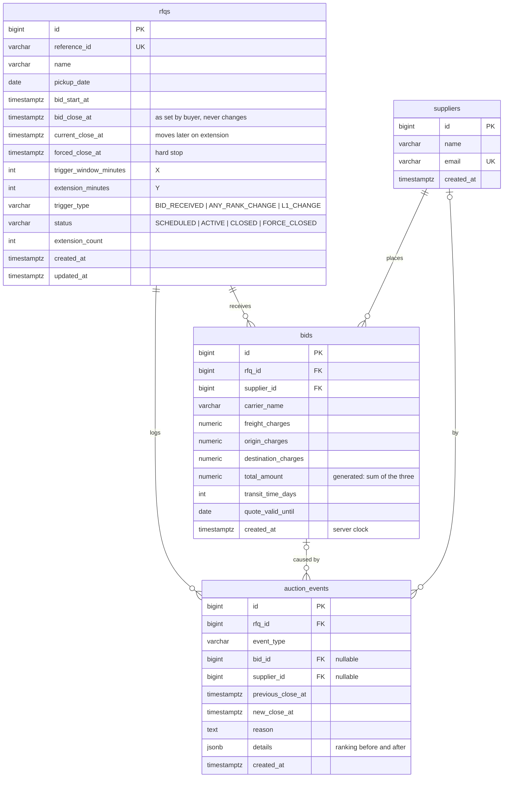

# Schema design

PostgreSQL, four tables. The migration is
[`backend/alembic/versions/20261103_4251f99e8609_initial_schema.py`](../backend/alembic/versions/20261103_4251f99e8609_initial_schema.py),
generated from [`backend/app/models.py`](../backend/app/models.py).
[auction-rules.md](auction-rules.md) explains the rules behind the constraints.

## Tables

### `rfqs`

One row per RFQ. Every RFQ in this system is a British auction, so the auction
settings (X, Y, trigger type) live on the same row. No separate config table is
needed, because they are always read together.

The three close times are kept apart on purpose:

- `bid_close_at` keeps what the buyer originally set, so the UI can show how
  far the auction was extended.
- `current_close_at` is the close time in force now. Only the bid transaction
  moves it.
- `forced_close_at` is the hard stop.

`status` is a cache for the listing page and for the closing job. The source of
truth is the times (see [auction-rules.md](auction-rules.md#status)).

### `suppliers`

The people who bid. Login is out of scope, so a supplier is just a name and a
unique email.

### `bids`

Every bid is kept. Bids are never updated or deleted, so the full price
history survives. A supplier's rank comes from their latest bid on that RFQ.

`total_amount` is a **generated column**: Postgres computes it from the three
charges. It cannot be written directly, so it can never disagree with its parts.

### `auction_events`

The activity log on the details page. Each event has a type, a readable
`reason`, and for extensions, the close time before and after. `details` (JSONB)
holds context such as the ranking before and after the bid, which explains why a
rank-change trigger fired.

| `event_type`           | Written when                                                    |
|------------------------|-----------------------------------------------------------------|
| `RFQ_CREATED`          | the RFQ is created                                              |
| `BID_PLACED`           | a bid is accepted                                               |
| `TIME_EXTENDED`        | a trigger fired and the close time moved                        |
| `EXTENSION_BLOCKED`    | a trigger fired, but the close time was already at forced close |
| `AUCTION_CLOSED`       | the auction ended at a close time before the forced close       |
| `AUCTION_FORCE_CLOSED` | the auction ended at the forced close                           |

## Rules the database enforces

These hold even if the application code has a bug:

| Constraint                                  | Rule                                                      |
|---------------------------------------------|-----------------------------------------------------------|
| `ck_rfqs_close_after_start`                 | bid close is after bid start                              |
| `ck_rfqs_forced_after_close`                | forced close is after bid close                           |
| `ck_rfqs_current_not_before_close`          | an extension never moves the close time earlier           |
| `ck_rfqs_current_within_forced`             | **no extension goes past the forced close**               |
| `ck_rfqs_trigger_window_positive`, `ck_rfqs_extension_positive` | X and Y are positive                  |
| `ck_bids_*_non_negative`, `ck_bids_total_positive` | charges are not negative; the total is above zero  |
| `ck_bids_transit_time_positive`             | transit time is positive                                  |
| `ck_auction_events_extension_moves_later`   | an extension event always moves the close time later      |
| `ck_rfqs_trigger_type`, `ck_rfqs_auction_status`, `ck_auction_events_event_type` | enum values are valid |

Enums are stored as `VARCHAR` plus a `CHECK` rather than as native Postgres
`ENUM` types, so a new value can be added with a plain migration instead of
`ALTER TYPE`.

## Indexes

| Index                              | Used by                                                     |
|------------------------------------|-------------------------------------------------------------|
| `uq_rfqs_reference_id`             | looking up an RFQ by its reference                          |
| `ix_rfqs_status_current_close_at`  | the closing job: open auctions whose close time has passed  |
| `ix_bids_rfq_supplier_created`     | latest bid per supplier, used for ranking                   |
| `ix_bids_rfq_total`                | lowest bid on an RFQ, for the listing page                  |
| `ix_auction_events_rfq_created`    | the activity log for one RFQ, in time order                 |

## Concurrency

A bid runs in one transaction that starts with `SELECT ... FOR UPDATE` on its
RFQ row. Bids on the same RFQ are therefore applied one at a time: each sees the
close time and ranking left by the one before. Bids on different RFQs don't
block each other.
